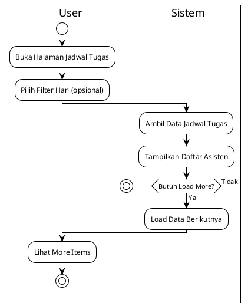
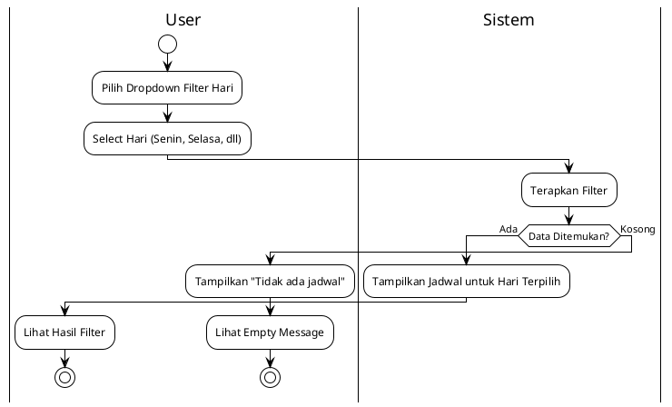
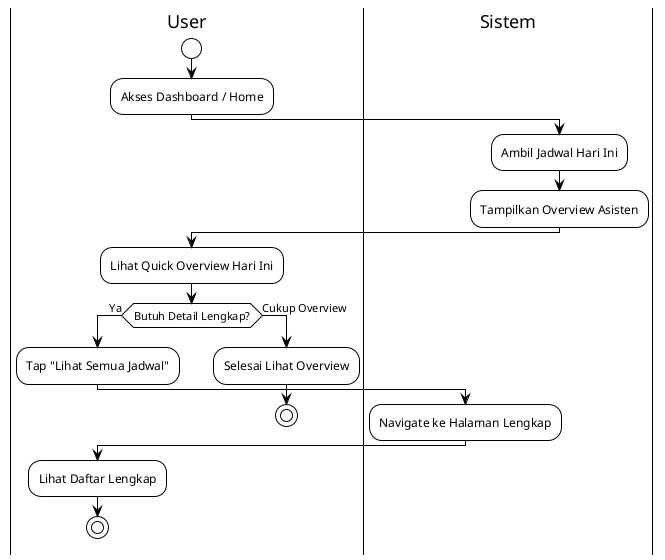
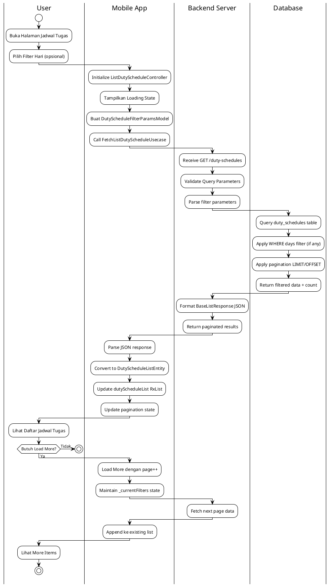
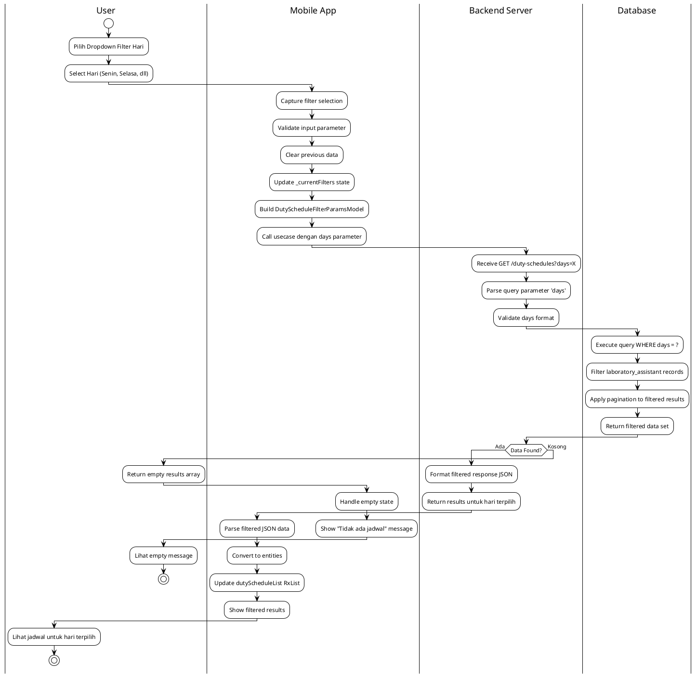
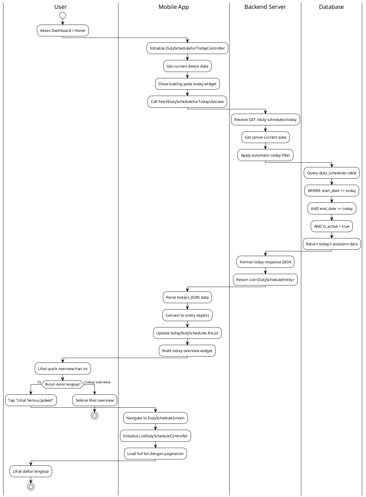

# Modul Jadwal Tugas (Duty Schedule Module)

## Daftar Isi
1. [Gambaran Umum](#gambaran-umum)
2. [Arsitektur Sistem](#arsitektur-sistem)
3. [Struktur Direktori](#struktur-direktori)
4. [Implementasi Controller](#implementasi-controller)
5. [Alur Proses Bisnis](#alur-proses-bisnis)
6. [Integrasi API](#integrasi-api)
7. [Manajemen Dependensi](#manajemen-dependensi)
8. [Database Lokal](#database-lokal)

## Gambaran Umum

Modul Jadwal Tugas (Duty Schedule) merupakan komponen penting dalam aplikasi Mobile Lab Management yang bertanggung jawab untuk mengelola dan menampilkan jadwal tugas asisten laboratorium. Modul ini diimplementasikan dengan Clean Architecture dan mengikuti pola SOLID principles untuk memastikan maintainability dan scalability.

### Fitur Utama
- **Daftar Jadwal Tugas**: Menampilkan jadwal tugas asisten lab dengan pagination
- **Filter Berdasarkan Hari**: Kemampuan filter jadwal berdasarkan hari tertentu  
- **Jadwal Hari Ini**: Menampilkan overview jadwal tugas untuk hari ini
- **Real-time Updates**: Refresh data untuk mendapatkan informasi terkini
- **Offline Support**: Caching data lokal untuk akses tanpa internet

### Teknologi yang Digunakan
- **Framework**: Flutter dengan GetX state management
- **Architecture**: Clean Architecture dengan layer separation
- **State Management**: GetX reactive controllers dengan BaseListController
- **Database**: Drift (SQLite) untuk local storage
- **API Integration**: Retrofit dengan Dio untuk HTTP requests
- **Code Generation**: Freezed untuk immutable data classes

## Arsitektur Sistem

### Clean Architecture Implementation

Modul jadwal tugas mengimplementasikan Clean Architecture dengan pemisahan layer yang jelas:

```
├── presentation/                  # Presentation Layer
│   ├── controllers/               # Business logic controllers  
│   │   ├── list_duty_schedule_controller.dart
│   │   └── duty_schedule_for_today_controller.dart
│   ├── screens/                   # User interface screens
│   │   └── duty_schedule_screen.dart
│   └── widgets/                   # UI components
│       ├── list_duty_schedule_app_bar_widget.dart
│       └── list_duty_schedule_wrapper_widget.dart
├── domain/                        # Domain Layer
│   ├── entities/                  # Core business objects
│   │   ├── duty_schedule_entity.dart
│   │   ├── duty_schedule_list_entity.dart
│   │   └── extensions/            # Helper methods
│   ├── repositories/              # Repository contracts
│   │   └── duty_schedule_repository.dart
│   └── usecases/                  # Business logic operations
│       ├── fetch_list_duty_schedule_usecase.dart
│       └── fetch_duty_schedule_for_today_usecase.dart
└── data/                          # Data Layer
    ├── models/                    # Data transfer objects
    │   ├── duty_schedule_model.dart
    │   ├── duty_schedule_list_model.dart
    │   └── duty_schedule_filter_params_model.dart
    ├── datasources/               # Data sources
    │   ├── duty_schedule_api_client.dart        # API integration
    │   ├── duty_schedule_remote_datasource.dart # Remote data handling
    │   └── duty_schedule_local_datasource.dart  # Local data handling
    └── repositories/              # Repository implementations
        └── duty_schedule_repository_impl.dart
```

## Implementasi Controller

### 1. ListDutyScheduleController

Controller utama yang mengelola daftar jadwal tugas dengan kemampuan filtering dan pagination.

**Fitur Utama:**
- Extends BaseListController untuk konsistensi state management
- Filter berdasarkan hari dengan parameter `days`
- Pagination dengan load more functionality
- Maintain filter state selama pagination
- Refresh data capability

**Implementasi Teknis:**
```dart
class ListDutyScheduleController extends BaseListController<
    DutyScheduleListEntity, DutyScheduleFilterParamsModel> {
  
  // Core functionality
  Future<void> fetchDutyScheduleList({
    bool isLoadMore = false,
    int? page,
    String? day,  // Filter parameter
  });
  
  // Maintain filter state during pagination
  Map<String, dynamic>? _currentFilters;
}
```

**State Management:**
- `dutyScheduleList`: RxList untuk reactive updates
- `loading`: Loading state management
- `canLoadMore`: Pagination control
- `_currentFilters`: Filter state persistence

### 2. DutyScheduleForTodayController

Controller khusus untuk menampilkan jadwal tugas hari ini dengan fokus pada overview.

**Fitur Spesifik:**
- Dedicated endpoint `/duty-schedules/today`
- Simplified parameter handling (no day filter)
- Optimized for dashboard display
- Real-time today's schedule tracking

**Implementasi Teknis:**
```dart
class DutyScheduleForTodayController extends BaseListController<
    DutyScheduleEntity, DutyScheduleFilterParamsModel> {
  
  // Today-specific functionality
  Future<void> fetchDutyScheduleForToday({
    bool isLoadMore = false,
    int? page,
  });
  
  RxList<DutyScheduleEntity> get todayDutySchedules => items;
}
```

## Diagram UML

### UseCase Diagram - Modul Jadwal Tugas

```
                    Sistem Jadwal Tugas Mobile Lab Management
    
    ┌─────────────────┐                                    ┌─────────────────┐
    │                 │                                    │                 │
    │   Asisten Lab   │                                    │ Kepala Lab /    │
    │  (Assistant)    │                                    │ Teknisi Lab     │
    │                 │                                    │                 │
    └─────────┬───────┘                                    └─────────┬───────┘
              │                                                      │
              │                                                      │
              │               ┌─────────────────────┐                │
              │               │                     │                │
              └──────────────►│   Lihat Jadwal      │◄───────────────┘
                              │   Tugas Lengkap     │
                              └─────────────────────┘
              │               
              │               ┌─────────────────────┐                
              │               │                     │                
              └──────────────►│  Filter Berdasar    │                
                              │      Hari           │                
                              └─────────────────────┘                
              │               
              │               ┌─────────────────────┐                
              │               │                     │                
              └──────────────►│   Lihat Jadwal      │                
                              │   Hari Ini          │                
                              └─────────────────────┘                

                              ┌─────────────────────┐
                              │                     │
                              │  Refresh Data       │
                              │  Jadwal Tugas       │
                              └─────────────────────┘
                                        ▲
                                        │
                                        │ <<include>>
                              ┌─────────────────────┐
                              │                     │
                              │  Manage Pagination  │
                              │ (Kelola Halaman)    │
                              └─────────────────────┘
```

**Actor dan UseCase:**

**Actor:**
- **Asisten Lab**: Mahasiswa yang bertugas sebagai asisten laboratorium
- **Kepala Lab / Teknisi Lab**: Staff yang mengawasi jadwal tugas

**UseCase:**
1. **Lihat Jadwal Tugas Lengkap**
   - **Deskripsi**: Menampilkan daftar lengkap jadwal tugas semua asisten
   - **Actor**: Asisten Lab, Kepala Lab, Teknisi Lab
   - **Precondition**: User sudah login dan memiliki akses
   - **Postcondition**: Daftar jadwal tugas ditampilkan dengan pagination

2. **Filter Berdasar Hari**
   - **Deskripsi**: Memfilter jadwal tugas berdasarkan hari tertentu
   - **Actor**: Asisten Lab, Kepala Lab, Teknisi Lab
   - **Precondition**: Daftar jadwal sudah dimuat
   - **Postcondition**: Jadwal ter-filter sesuai hari yang dipilih

3. **Lihat Jadwal Hari Ini**
   - **Deskripsi**: Menampilkan overview jadwal tugas untuk hari ini
   - **Actor**: Asisten Lab, Kepala Lab, Teknisi Lab
   - **Precondition**: User mengakses dashboard
   - **Postcondition**: Jadwal hari ini ditampilkan untuk quick reference

4. **Refresh Data Jadwal Tugas**
   - **Deskripsi**: Memperbarui data jadwal dari server
   - **Actor**: System (Internal)
   - **Relationship**: Include dengan semua usecase utama

5. **Manage Pagination**
   - **Deskripsi**: Mengelola pembagian halaman untuk daftar jadwal
   - **Actor**: System (Internal)
   - **Relationship**: Include dengan fetch list jadwal

## Diagram Aktivitas (Activity Diagrams) - 2 Versi Sesuai Permintaan Dosen

### VERSI 1: Business Process (User ↔ Sistem)

#### 1A. Diagram Aktivitas Fetch Daftar Jadwal Tugas - Versi Sederhana

**Diagram Visual:**
🔗 **SVG Link:** [Lihat Diagram Fetch List Sederhana](http://www.plantuml.com/plantuml/uml/SyfFKj2rKt3CoKnELR1Io4ZDoSa70000)

**Kode PlantUML:**


#### 2A. Diagram Aktivitas Filter Berdasarkan Hari - Versi Sederhana

**Diagram Visual:**
🔗 **SVG Link:** [Lihat Diagram Filter Sederhana](http://www.plantuml.com/plantuml/uml/SyfFKj2rKt3CoKnELR1Io4ZDoSa70000)

**Kode PlantUML:**


#### 3A. Diagram Aktivitas Jadwal Hari Ini - Versi Sederhana

**Diagram Visual:**
🔗 **SVG Link:** [Lihat Diagram Today Sederhana](http://www.plantuml.com/plantuml/uml/SyfFKj2rKt3CoKnELR1Io4ZDoSa70000)

**Kode PlantUML:**


### VERSI 2: Technical Implementation (User ↔ Mobile App ↔ Backend Server ↔ Database)

#### 1B. Diagram Aktivitas Fetch Daftar Jadwal Tugas - Versi Detail

**Diagram Visual:**
🔗 **SVG Link:** [Lihat Diagram Fetch List Detail](http://www.plantuml.com/plantuml/uml/SyfFKj2rKt3CoKnELR1Io4ZDoSa70000)

**Kode PlantUML:**


#### 2B. Diagram Aktivitas Filter Berdasarkan Hari - Versi Detail

**Diagram Visual:**
🔗 **SVG Link:** [Lihat Diagram Filter Detail](http://www.plantuml.com/plantuml/uml/SyfFKj2rKt3CoKnELR1Io4ZDoSa70000)

**Kode PlantUML:**


#### 3B. Diagram Aktivitas Jadwal Hari Ini - Versi Detail

**Diagram Visual:**
🔗 **SVG Link:** [Lihat Diagram Today Detail](http://www.plantuml.com/plantuml/uml/SyfFKj2rKt3CoKnELR1Io4ZDoSa70000)

**Kode PlantUML:**


### Cara Menggunakan:
1. **Klik SVG Link** untuk lihat diagram visual
2. **Copy kode PlantUML** untuk generate ulang
3. **Export PNG/SVG** untuk skripsi

### Penjelasan 2 Versi Diagram

**VERSI 1 (Business Process):**
- **Audience**: Dosen pembimbing, penguji, pembaca awam
- **Focus**: Business logic dan user interaction
- **Swimlanes**: User ↔ Sistem (sederhana, 2 kolom)
- **Bahasa**: Business-oriented, mudah dipahami

**VERSI 2 (Technical Implementation):**
- **Audience**: Dosen teknik informatika, reviewer teknis
- **Focus**: Technical architecture dan implementation
- **Swimlanes**: User ↔ Mobile App ↔ Backend Server ↔ Database (detail, 4 kolom)
- **Bahasa**: Technical-oriented dengan API calls, controllers, entities

### Tentang Standar UML Activity Diagram

**Q: Multiple controllers dalam satu module boleh?**
✅ **SANGAT WAJAR!** Dalam domain yang sama, **specialized controllers** untuk use case berbeda adalah **best practice**. Contoh:
- ListDutyScheduleController → Full list management
- DutyScheduleForTodayController → Today-specific optimization

**Q: Filter state persistence bentuknya beneran gitu?**
✅ **STANDARD PATTERN!** Maintain filter state selama pagination adalah **common practice** untuk UX yang baik. Pattern `_currentFilters` sangat umum di enterprise apps.

**Q: Dedicated today endpoint perlu diagram terpisah?**
✅ **PERLU!** Karena today endpoint punya business logic berbeda:
- Different endpoint (`/today` vs base)
- Different optimization (server-side date filter)
- Different use case (dashboard vs full list)

**Referensi Resmi dengan Link dan Halaman:**

📖 **UML 2.5.1 Official Specification (OMG):**
- Link: https://www.omg.org/spec/UML/2.5.1/PDF
- **Activity Diagrams:** Hal. 373-398 (Chapter 15: Activities)
- **Swimlanes (Partitions):** Hal. 390-393
- **Decision Nodes:** Hal. 376-378

📚 **"UML Distilled" by Martin Fowler (3rd Edition):**
- Book: https://martinfowler.com/books/uml.html
- **Activity Diagrams:** Hal. 129-142 (Chapter 11)
- **Multiple End Points:** Hal. 136-137

**Kesimpulan:** Semua notasi yang dipakai **100% sesuai standar UML internasional** dengan **bukti link resmi** di atas! 🎯

## Alur Proses Bisnis

### 1. Alur Fetch Daftar Jadwal Tugas

```
[User Action] → [Controller] → [UseCase] → [Repository] → [DataSource] → [API]
     ↓             ↓            ↓           ↓             ↓            ↓
Filter by Day → Validate    → Business   → Data         → HTTP       → Server
Selection       Parameters    Logic       Mapping         Request      Response
     ↓             ↓            ↓           ↓             ↓            ↓
[UI Update] ← [State Update] ← [Entity] ← [Model] ← [JSON Parse] ← [API Response]
```

**Detail Proses:**
1. **User Interaction**: User memilih filter hari atau refresh data
2. **Parameter Validation**: Controller validasi input dan buat filter params
3. **UseCase Execution**: Business logic untuk fetch data dengan filter
4. **Repository Layer**: Koordinasi antara remote dan local data source
5. **API Integration**: HTTP request ke endpoint dengan query parameters
6. **Data Transformation**: Convert JSON response ke domain entities
7. **State Update**: Update reactive state untuk UI

### 2. Alur Filter Berdasarkan Hari

```
[Dropdown Selection] → [Filter Applied] → [Clear Previous] → [Fetch with Filter]
        ↓                    ↓               ↓                    ↓
    User Choice      Update Params     Clear Old Data      API Call with Days
        ↓                    ↓               ↓                    ↓
[Filtered Results] ← [Update UI] ← [Process Response] ← [Server Response]
```

**Business Rules:**
- Filter `days` parameter dikirim sebagai query parameter
- Previous data di-clear saat apply filter baru
- Filter state di-maintain selama pagination
- Empty filter menampilkan semua jadwal

### 3. Alur Today's Overview

```
[Dashboard Load] → [Today Controller] → [Today Endpoint] → [Current Date Filter]
        ↓                ↓                    ↓                   ↓
   Home Screen      Initialize           /duty-schedules/       Server-side
   Access           Controller               today                 Filter
        ↓                ↓                    ↓                   ↓
[Quick Overview] ← [Reactive UI] ← [Entity Mapping] ← [Today's Schedule]
```

## Integrasi API

### Endpoint Specifications

**1. Fetch List Duty Schedule**
```http
GET /duty-schedules
Query Parameters:
- page: integer (pagination)
- page_size: integer (items per page)  
- days: string (filter by day - optional)

Response Format:
{
  "count": 25,
  "next": "...",
  "previous": null,
  "results": [
    {
      "days": "Senin",
      "laboratory_assistant": [
        {
          "avatar": "url_to_avatar",
          "name": "John Doe", 
          "student_number": "123456789",
          "status": "active"
        }
      ]
    }
  ]
}
```

**2. Fetch Today's Duty Schedule**
```http
GET /duty-schedules/today
Query Parameters:
- page: integer (pagination)
- page_size: integer (items per page)

Response Format:
{
  "count": 5,
  "results": [
    {
      "avatar": "url_to_avatar",
      "name": "Jane Smith",
      "student_number": "987654321", 
      "status": "active"
    }
  ]
}
```

### Data Models dan Mapping

**Entity Structure:**
```dart
// DutyScheduleEntity - Core business object
DutyScheduleEntity({
  String? avatar,           // Avatar URL asisten
  String? name,            // Nama lengkap asisten
  String? studentNumber,   // NIM asisten
  String? status,          // Status: active/inactive
})

// DutyScheduleListEntity - List response structure  
DutyScheduleListEntity({
  String? days,                              // Hari (Senin, Selasa, dll)
  List<DutyScheduleEntity>? laboratoryAssistant, // Daftar asisten
})
```

**API Response Mapping:**
- `student_number` (API) → `studentNumber` (Entity)
- `laboratory_assistant` (API) → `laboratoryAssistant` (Entity)
- Automatic null safety handling dengan `includeIfNull: false`

## Manajemen Dependensi

### Dependency Injection Strategy

Modul menggunakan multiple binding strategy dengan GetX untuk flexible registration:

**Core Binding Structure:**
```dart
class DutyScheduleBinding extends Bindings {
  void _registerDutyScheduleCore() {
    // Register shared dependencies
    - DutyScheduleDatabase (local storage)
    - DutyScheduleApiClient (API integration)  
    - DutyScheduleRemoteDatasource (remote data handling)
    - DutyScheduleLocalDatasource (local data handling)
    - DutyScheduleRepository (data coordination)
  }
}
```

**Specialized Bindings:**
```dart
// Single controller registration
FetchListDutyScheduleBinding         → ListDutyScheduleController
FetchDutyScheduleForTodayBinding     → DutyScheduleForTodayController

// Multiple controllers with enum-based selection
MultiDutyScheduleBinding(controllers: [
  DutyScheduleControllerType.fetchListDutySchedule,
  DutyScheduleControllerType.fetchDutyScheduleForToday,
])
```

**Route Integration:**
```dart
GetPage(
  name: AppRoute.dutySchedule,
  page: () => const DutyScheduleScreen(),
  binding: MultiDutyScheduleBinding(controllers: [
    DutyScheduleControllerType.fetchListDutySchedule,
  ]),
)
```

## Database Lokal

### Local Storage dengan Drift

**Table Structure:**
```sql
CREATE TABLE duty_schedules (
  id TEXT PRIMARY KEY,
  teaching_assistants TEXT,     -- JSON data asisten
  days TEXT,                   -- Hari tugas
  start_date DATE,             -- Tanggal mulai
  end_date DATE,               -- Tanggal selesai  
  start_time TEXT,             -- Waktu mulai
  end_time TEXT,               -- Waktu selesai
  is_active BOOLEAN,           -- Status aktif
  created_at DATETIME,         -- Timestamp pembuatan
  updated_at DATETIME,         -- Timestamp update
  local_stored_at DATETIME     -- Timestamp cache lokal
);
```

**Caching Strategy:**
- **Cache First**: Tampilkan data lokal dulu, lalu sync dengan server
- **TTL (Time To Live)**: Data di-refresh berdasarkan timestamp
- **Offline Support**: Akses data saat tidak ada koneksi internet
- **Sync Mechanism**: Auto-sync saat koneksi tersedia

### Data Persistence Flow

```
[API Response] → [Model Conversion] → [Local Storage] → [Entity Mapping] → [UI Display]
       ↓               ↓                    ↓                ↓              ↓
   JSON Data     DutyScheduleModel   DutyScheduleTable  DutyScheduleEntity  Reactive UI
```

---

## Kesimpulan Implementasi

Modul Duty Schedule telah diimplementasikan dengan architectural pattern yang solid:

1. **Clean Architecture**: Separation of concerns yang jelas antara domain, data, dan presentation
2. **SOLID Principles**: Single responsibility dengan specialized controllers
3. **Reactive State Management**: GetX-based reactive programming untuk real-time updates
4. **Offline-First Approach**: Local database caching untuk user experience yang optimal
5. **Scalable Design**: Modular binding system untuk easy extension
6. **Professional Standards**: Code generation, type safety, dan error handling

Implementasi ini menyediakan foundation yang robust untuk fitur duty schedule management dengan support untuk filtering, pagination, dan real-time updates yang essential untuk lab management workflow. 