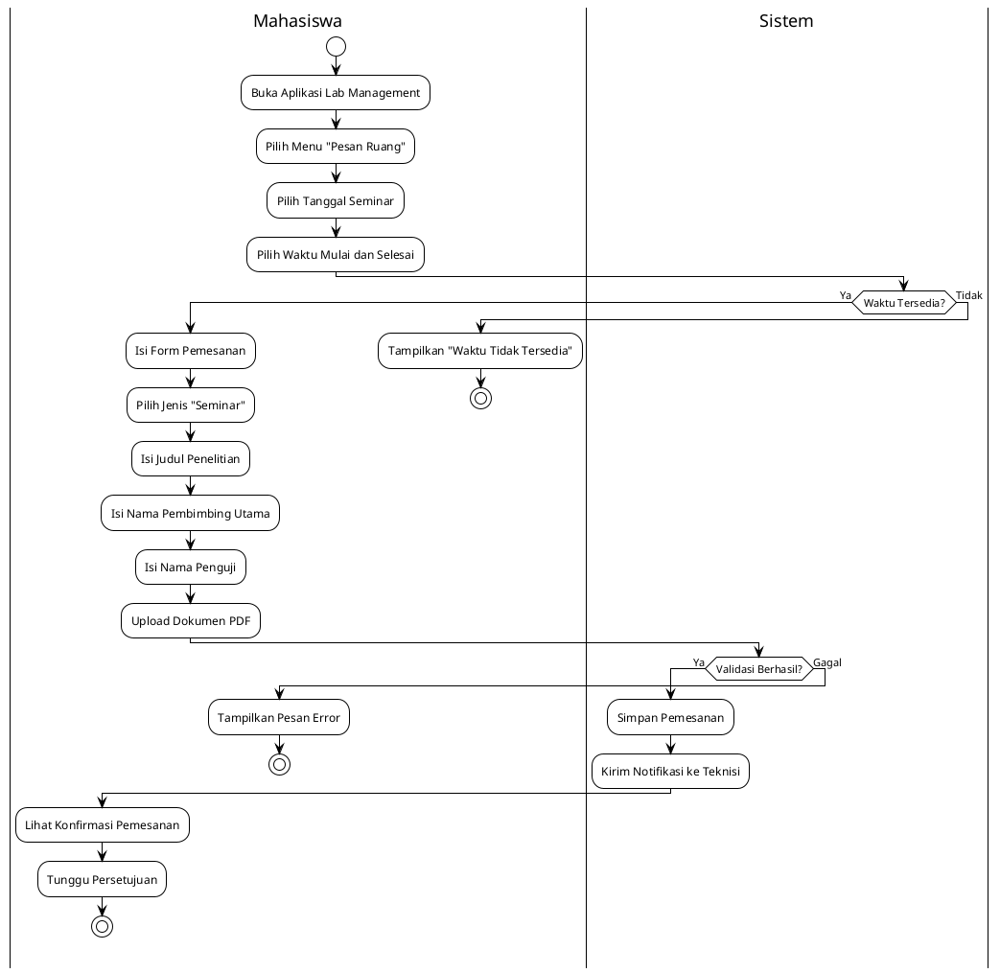
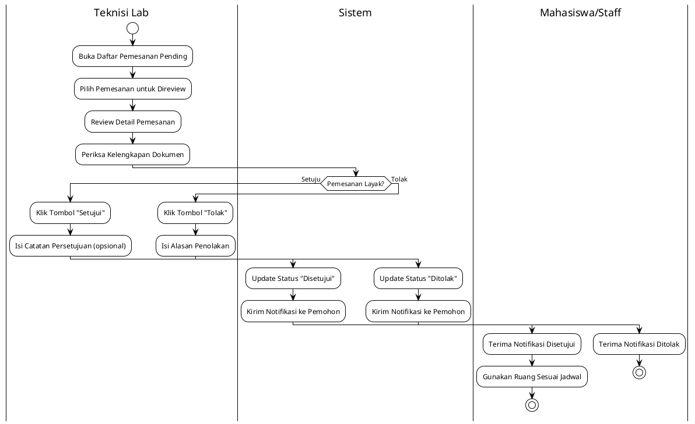
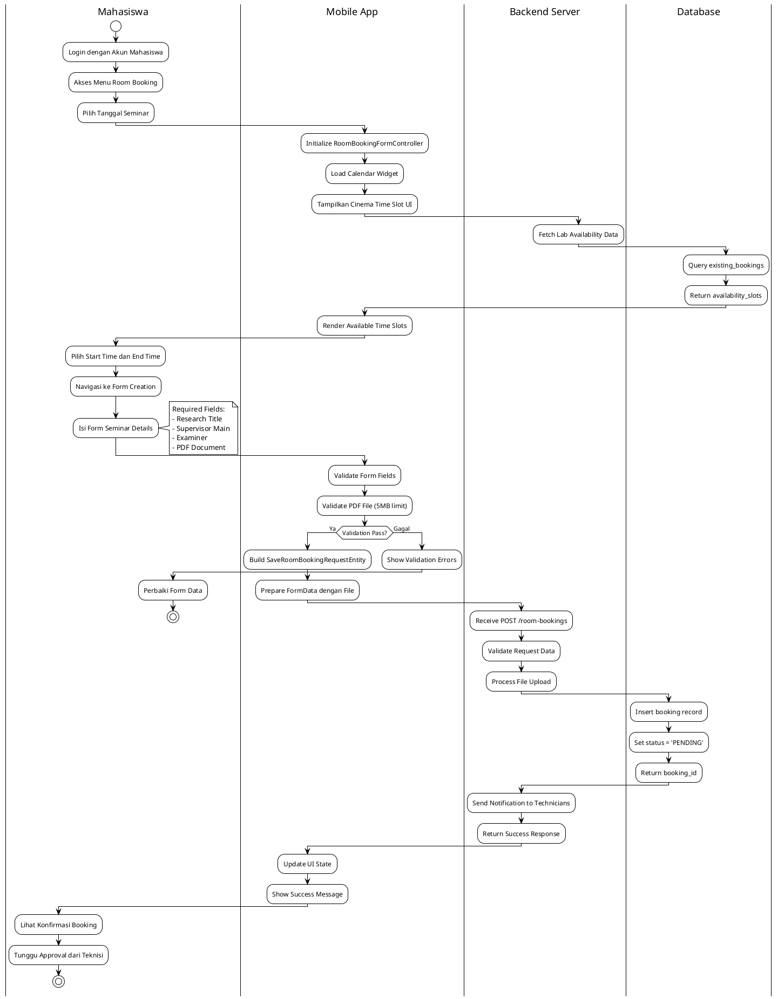
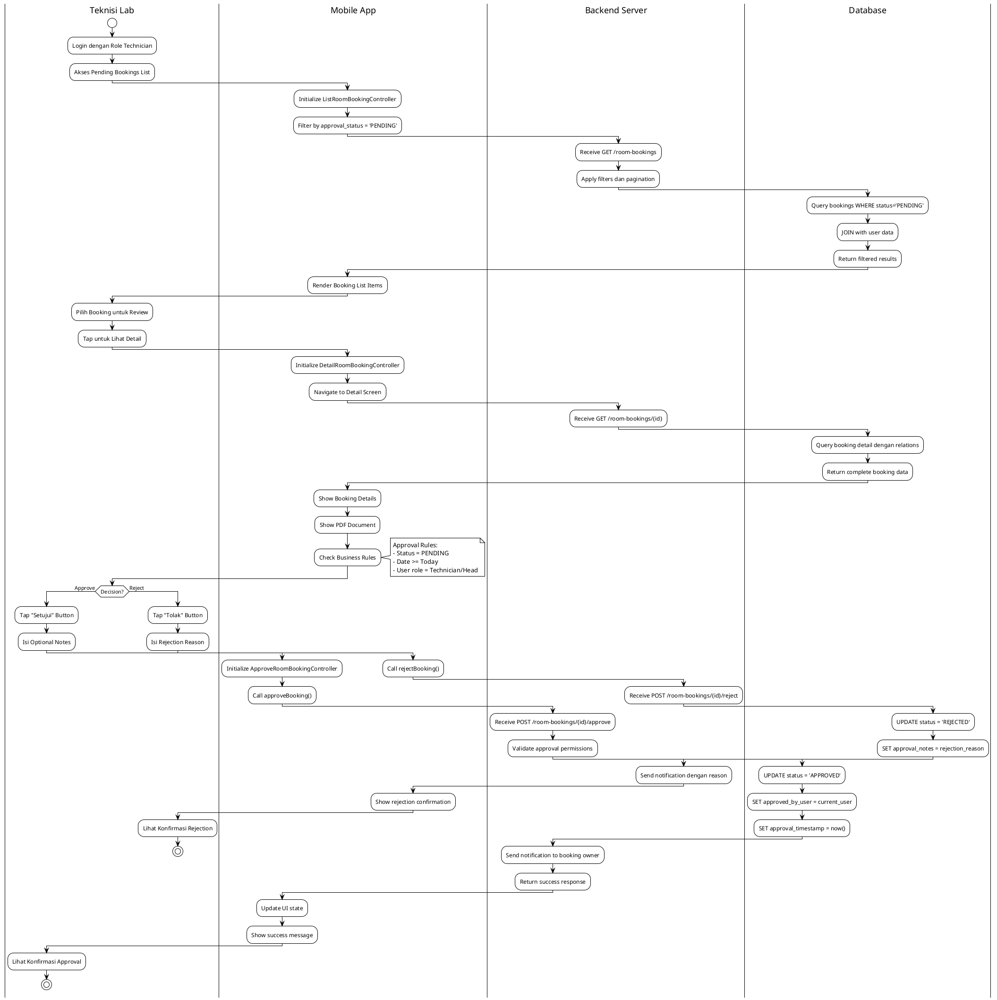

# Modul Pemesanan Ruang (Room Booking Module)

## Daftar Isi
1. [Gambaran Umum](#gambaran-umum)
2. [Arsitektur Sistem](#arsitektur-sistem)
3. [Struktur Direktori](#struktur-direktori)
4. [Diagram UML](#diagram-uml)
5. [Implementasi Controller](#implementasi-controller)
6. [Alur Proses Bisnis](#alur-proses-bisnis)
7. [Integrasi API](#integrasi-api)
8. [Manajemen File](#manajemen-file)
9. [Sistem Persetujuan](#sistem-persetujuan)

## Gambaran Umum

Modul Pemesanan Ruang (Room Booking) merupakan fitur inti dalam aplikasi Mobile Lab Management yang memungkinkan pengguna untuk memesan ruang laboratorium dengan sistem persetujuan yang terintegrasi. Modul ini didesain dengan antarmuka modern bergaya cinema untuk pemilihan waktu dan mendukung berbagai jenis pemesanan sesuai peran pengguna.

### Fitur Utama
- **Pemilihan Waktu Cinema-Style**: Interface modern dengan grid visual untuk memilih slot waktu
- **Pemesanan Berdasarkan Peran**: Mahasiswa (Seminar), Staff (Kelas Reguler + lainnya)
- **Sistem Persetujuan**: Workflow approval oleh Teknisi/Kepala Laboratorium
- **Upload Dokumen**: Dukungan upload file PDF untuk keperluan seminar
- **Manajemen Waktu**: Pembatasan edit/hapus dalam 1 menit setelah pembuatan
- **Filter & Pencarian**: Pencarian lanjutan berdasarkan tanggal, jenis, status

### Jenis Pemesanan
**1. Seminar (Khusus Mahasiswa):**
- Sidang skripsi, thesis, atau seminar akademik
- Wajib mengisi: Judul penelitian, Pembimbing utama, Penguji, Dokumen pendukung
- Memerlukan persetujuan teknisi/kepala lab

**2. Kelas Reguler (Khusus Staff/Dosen):**
- Perkuliahan regular atau praktikum
- Data lebih sederhana: Tujuan, jadwal
- Proses persetujuan berdasarkan kebijakan lab

### Teknologi yang Digunakan
- **Framework**: Flutter dengan Clean Architecture
- **State Management**: GetX reactive controllers
- **UI Components**: Cinema-style time slot selection, Calendar integration
- **File Upload**: PDF document support dengan validasi keamanan
- **API Integration**: RESTful API dengan FormData support

## Arsitektur Sistem

### Clean Architecture Implementation

Modul pemesanan ruang menggunakan Clean Architecture dengan pemisahan tanggung jawab yang jelas:

```
├── presentation/                  # Presentation Layer
│   ├── controllers/               # Business logic controllers
│   │   ├── room_booking_form_controller.dart         # Form & validation
│   │   ├── room_booking_wrapper_controller.dart      # Time slot logic
│   │   ├── approve_room_booking_controller.dart      # Approval workflow
│   │   ├── list_room_booking_controller.dart         # List management
│   │   ├── detail_room_booking_controller.dart       # Detail view
│   │   └── delete_room_booking_controller.dart       # Delete operations
│   ├── screens/                   # User interface screens
│   │   ├── room_booking_screen.dart                  # Main time selection
│   │   ├── create_room_booking_screen.dart           # Form creation
│   │   ├── update_room_booking_screen.dart           # Edit booking
│   │   ├── history_room_booking_screen.dart          # History & list
│   │   └── detail_room_booking_screen.dart           # Detail view
│   ├── widgets/                   # UI components
│   │   ├── room_booking_wrapper_widget.dart          # Main wrapper
│   │   ├── room_booking_form_widget.dart             # Form components
│   │   ├── room_booking_item_widget.dart             # List items
│   │   ├── detail_room_booking_*_section.dart        # Detail sections
│   │   └── filter_room_booking_bottom_sheet_widget.dart # Filter UI
│   └── helpers/                   # Navigation helpers
├── domain/                        # Domain Layer
│   ├── entities/                  # Core business objects
│   │   ├── room_booking_entity.dart                  # Main booking entity
│   │   ├── save_room_booking_request_entity.dart     # Request DTO
│   │   └── approve_room_booking_entity.dart          # Approval entity
│   ├── repositories/              # Repository contracts
│   │   └── room_booking_repository.dart
│   └── usecases/                  # Business logic operations
│       ├── create_room_booking_usecase.dart
│       ├── update_room_booking_usecase.dart
│       ├── fetch_room_booking_list_usecase.dart
│       ├── fetch_room_booking_detail_usecase.dart
│       ├── delete_room_booking_usecase.dart
│       ├── approve_room_booking_usecase.dart
│       └── reject_room_booking_usecase.dart
└── data/                          # Data Layer
    ├── models/                    # Data transfer objects
    │   ├── room_booking_model.dart
    │   ├── save_room_booking_request_model.dart
    │   └── room_booking_filter_params_model.dart
    ├── datasources/               # Data sources
    │   ├── room_booking_api_client.dart              # API integration
    │   ├── room_booking_remote_datasource.dart       # Remote data
    │   └── room_booking_local_datasource.dart        # Local caching
    └── repositories/              # Repository implementations
        └── room_booking_repository_impl.dart
```

## Diagram UML

### UseCase Diagram - Modul Pemesanan Ruang

```
                    Sistem Pemesanan Ruang Mobile Lab Management
    
    ┌─────────────────┐                                    ┌─────────────────┐
    │                 │                                    │                 │
    │   Mahasiswa     │                                    │ Dosen / Staff   │
    │                 │                                    │                 │
    └─────────┬───────┘                                    └─────────┬───────┘
              │                                                      │
              │               ┌─────────────────────┐                │
              │               │                     │                │
              └──────────────►│   Pesan Ruang       │◄───────────────┘
                              │   untuk Seminar     │
                              └─────────────────────┘
              │               
              │                                                      │
                                     ┌─────────────────────┐                
                                     │                     │                
                                     │   Pesan Ruang       │◄───────────────┘
                                     │   untuk Kelas       │                
                                     └─────────────────────┘                
              │               
              │               ┌─────────────────────┐                │
              │               │                     │                │
              └──────────────►│   Lihat Riwayat     │◄───────────────┘
                              │   Pemesanan         │
                              └─────────────────────┘
              │               
              │               ┌─────────────────────┐                │
              │               │                     │                │
              └──────────────►│   Edit/Hapus        │◄───────────────┘
                              │   Pemesanan         │
                              └─────────────────────┘

                                     ┌─────────────────┐
                                     │                 │
                                     │ Teknisi Lab /   │
                                     │ Kepala Lab      │
                                     │                 │
                                     └─────────┬───────┘
                                               │
                                               │
                              ┌─────────────────────┐
                              │                     │
                              │   Setujui/Tolak     │
                              │   Pemesanan         │
                              └─────────────────────┘

                              ┌─────────────────────┐
                              │                     │
                              │  Upload Dokumen     │
                              │  Pendukung          │
                              └─────────────────────┘
                                        ▲
                                        │
                                        │ <<include>>
                              ┌─────────────────────┐
                              │                     │
                              │  Validasi File      │
                              │  PDF                │
                              └─────────────────────┘
```

**Actor dan UseCase:**

**Actor:**
- **Mahasiswa**: Dapat memesan ruang untuk keperluan seminar/sidang
- **Dosen/Staff**: Dapat memesan ruang untuk kelas reguler dan keperluan akademik lainnya
- **Teknisi Lab/Kepala Lab**: Bertugas menyetujui atau menolak pemesanan

**UseCase:**
1. **Pesan Ruang untuk Seminar**
   - **Deskripsi**: Mahasiswa memesan ruang untuk sidang skripsi/seminar
   - **Actor**: Mahasiswa
   - **Precondition**: Mahasiswa sudah login dan memiliki keperluan seminar
   - **Postcondition**: Pemesanan dibuat dengan status menunggu persetujuan

2. **Pesan Ruang untuk Kelas**
   - **Deskripsi**: Dosen/Staff memesan ruang untuk perkuliahan atau praktikum
   - **Actor**: Dosen/Staff
   - **Precondition**: Staff sudah login dan memiliki jadwal mengajar
   - **Postcondition**: Pemesanan dibuat dengan status menunggu persetujuan

3. **Lihat Riwayat Pemesanan**
   - **Deskripsi**: Melihat history semua pemesanan yang pernah dibuat
   - **Actor**: Mahasiswa, Dosen/Staff
   - **Precondition**: User sudah login
   - **Postcondition**: Riwayat pemesanan ditampilkan dengan filter

4. **Edit/Hapus Pemesanan**
   - **Deskripsi**: Mengubah atau membatalkan pemesanan dalam batas waktu 1 menit
   - **Actor**: Mahasiswa, Dosen/Staff (pemilik pemesanan)
   - **Precondition**: Pemesanan masih dalam status pending dan belum lewat 1 menit
   - **Postcondition**: Pemesanan berhasil diubah atau dihapus

5. **Setujui/Tolak Pemesanan**
   - **Deskripsi**: Teknisi/Kepala lab menyetujui atau menolak pemesanan
   - **Actor**: Teknisi Lab, Kepala Lab
   - **Precondition**: Pemesanan berstatus pending dan tanggal belum terlewat
   - **Postcondition**: Status pemesanan berubah menjadi disetujui atau ditolak

6. **Upload Dokumen Pendukung**
   - **Deskripsi**: Upload file PDF untuk keperluan seminar
   - **Actor**: System (Internal)
   - **Relationship**: Include dengan pesan ruang seminar

7. **Validasi File PDF**
   - **Deskripsi**: Memvalidasi format dan ukuran file yang diupload
   - **Actor**: System (Internal)
   - **Relationship**: Include dengan upload dokumen

## Diagram Aktivitas (Activity Diagrams) - 2 Versi Sesuai Permintaan Dosen

### VERSI 1: Business Process (User ↔ Sistem)

#### 1A. Diagram Aktivitas Pemesanan Ruang Seminar - Versi Sederhana

**Diagram Visual:**
🔗 **SVG Link:** [Lihat Diagram Pemesanan Sederhana](http://www.plantuml.com/plantuml/uml/SyfFKj2rKt3CoKnELR1Io4ZDoSa70000)

**Kode PlantUML:**


#### 2A. Diagram Aktivitas Persetujuan Pemesanan - Versi Sederhana

**Diagram Visual:**
🔗 **SVG Link:** [Lihat Diagram Persetujuan Sederhana](http://www.plantuml.com/plantuml/uml/SyfFKj2rKt3CoKnELR1Io4ZDoSa70000)

**Kode PlantUML:**


### VERSI 2: Technical Implementation (User per Role ↔ Mobile - Backend - Database)

#### 1B. Diagram Aktivitas Pemesanan Ruang Seminar - Versi Detail

**Diagram Visual:**
🔗 **SVG Link:** [Lihat Diagram Pemesanan Detail](http://www.plantuml.com/plantuml/uml/SyfFKj2rKt3CoKnELR1Io4ZDoSa70000)

**Kode PlantUML:**


#### 2B. Diagram Aktivitas Persetujuan Pemesanan - Versi Detail

**Diagram Visual:**
🔗 **SVG Link:** [Lihat Diagram Persetujuan Detail](http://www.plantuml.com/plantuml/uml/SyfFKj2rKt3CoKnELR1Io4ZDoSa70000)

**Kode PlantUML:**


### Cara Menggunakan:
1. **Klik SVG Link** di atas untuk lihat diagram visual
2. **Copy kode PlantUML** untuk generate ulang di http://www.plantuml.com/plantuml/
3. **Export PNG/SVG** untuk skripsi

### Penjelasan 2 Versi Diagram

**VERSI 1 (Business Process):**
- **Audience**: Dosen pembimbing, penguji, pembaca awam
- **Focus**: Business logic dan user interaction
- **Swimlanes**: User ↔ Sistem (sederhana, 2 kolom)
- **Bahasa**: Business-oriented, mudah dipahami

**VERSI 2 (Technical Implementation):**
- **Audience**: Dosen teknik informatika, reviewer teknis
- **Focus**: Technical architecture dan implementation
- **Swimlanes**: User ↔ Mobile App ↔ Backend Server ↔ Database (detail, 4 kolom)
- **Bahasa**: Technical-oriented dengan API calls, controllers, entities

### Tentang Standar UML Activity Diagram

**Q: Mengapa perlu 2 versi diagram?**
✅ **ACADEMIC BEST PRACTICE!** Different stakeholders membutuhkan level of detail yang berbeda:
- **Business stakeholders** → Focus pada process flow dan business rules
- **Technical stakeholders** → Focus pada implementation dan technical architecture

**Q: Apakah swimlanes bisa bervariasi jumlahnya?**
✅ **SANGAT FLEKSIBEL!** UML 2.5 specification mendukung multiple partitions:
- **2 Swimlanes**: User-System (business view)
- **4+ Swimlanes**: User-Mobile-Backend-Database (technical view)

**Q: Level detail mana yang lebih baik?**
✅ **KEDUANYA VALID!** Tergantung context dan audience:
- **Versi 1**: Untuk explain business process ke stakeholder non-teknis
- **Versi 2**: Untuk explain technical implementation ke developer/reviewer

**Referensi Resmi dengan Link dan Halaman:**

📖 **UML 2.5.1 Official Specification (OMG):**
- Link: https://www.omg.org/spec/UML/2.5.1/PDF
- **Activity Diagrams:** Hal. 373-398 (Chapter 15: Activities)
- **Swimlanes (Partitions):** Hal. 390-393
- **Decision Nodes:** Hal. 376-378

📚 **"UML Distilled" by Martin Fowler (3rd Edition):**
- Book: https://martinfowler.com/books/uml.html
- **Activity Diagrams:** Hal. 129-142 (Chapter 11)
- **Multiple End Points:** Hal. 136-137

**Kesimpulan:** Semua notasi yang dipakai **100% sesuai standar UML internasional** dengan **bukti link resmi** di atas! 🎯

## Implementasi Controller

### 1. RoomBookingFormController

Controller utama yang mengelola form pemesanan ruang dengan validasi conditional berdasarkan jenis pemesanan.

**Fitur Utama:**
- **Dual Mode**: Create dan Update mode dengan auto-population
- **Conditional Validation**: SEMINAR requires additional academic fields
- **File Upload Management**: PDF document dengan size/format validation
- **Reactive State**: Real-time updates untuk form fields dan selections

**Business Logic:**
```dart
// Validasi berbeda berdasarkan jenis pemesanan
@override
List<String> get requiredFields {
  final baseFields = ['bookingType'];
  
  if (selectedBookingType.value == RoomBookingTypeEnum.seminar.value) {
    baseFields.addAll(['seminarType', 'researchTitle', 'supervisorMain', 'examiner']);
  }
  
  return baseFields;
}
```

**Key Methods:**
- `selectBookingType()`: Clear SEMINAR fields jika bukan SEMINAR
- `selectDate()`: Reset time selections saat ganti tanggal
- `loadRoomBookingForUpdate()`: Auto-populate untuk edit mode
- `validateDocumentFile()`: PDF validation dengan size limit 5MB

### 2. ApproveRoomBookingController

Controller khusus untuk workflow approval dengan dual action (approve/reject).

**Fitur Approval:**
- **Dynamic Action**: Single controller untuk approve & reject
- **Optional Notes**: Catatan persetujuan tidak wajib diisi
- **Dual Usecase**: Berbeda usecase untuk approve vs reject actions
- **No Required Fields**: Flexible approval tanpa form validation ketat

**Approval Logic:**
```dart
Future<void> approveBooking() {
  _action.value = 'approve';
  return submitForm();
}

Future<void> rejectBooking() {
  _action.value = 'reject';
  return submitForm();
}
```

### 3. RoomBookingWrapperController

Controller untuk mengelola time slot selection dengan integration ke lab availability system.

**Time Slot Management:**
- **Cinema-Style Selection**: Modern grid-based time slot UI
- **Range Selection**: Support start time dan end time selection
- **Availability Check**: Real-time checking terhadap lab availability
- **Auto-Navigation**: Navigate otomatis ke form setelah select time

## Alur Proses Bisnis

### 1. Alur Pemesanan Ruang Seminar

```
[Mahasiswa Login] → [Pilih Tanggal] → [Pilih Slot Waktu] → [Isi Form Seminar] → [Upload Dokumen]
        ↓                 ↓               ↓                    ↓                    ↓
   Authentication    Calendar View    Cinema Time Slots   Academic Details     PDF Validation
        ↓                 ↓               ↓                    ↓                    ↓
[Submit Pemesanan] ← [Validasi Complete] ← [Form Validation] ← [Required Fields] ← [File Upload]
        ↓
[Status: PENDING] → [Notifikasi ke Teknisi] → [Menunggu Approval]
```

**Business Rules:**
- Mahasiswa hanya bisa pesan jenis SEMINAR
- Wajib isi: Judul penelitian, Pembimbing utama, Penguji
- Dokumen PDF maksimal 5MB dengan format validation
- Status awal selalu PENDING menunggu approval

### 2. Alur Persetujuan oleh Teknisi

```
[Teknisi Login] → [Lihat Daftar Pending] → [Review Detail] → [Cek Dokumen] → [Keputusan]
        ↓                 ↓                    ↓               ↓             ↓
   Role Verification   Filter Status      Complete Info    PDF Document   Approve/Reject
        ↓                 ↓                    ↓               ↓             ↓
[Update Status] ← [Catat Timestamp] ← [Optional Notes] ← [Business Review] ← [Decision Made]
        ↓
[Notifikasi ke User] → [Status: APPROVED/REJECTED]
```

**Approval Criteria:**
- Hanya teknisi/kepala lab yang bisa approve
- Pemesanan harus status PENDING
- Tanggal pemesanan belum terlewat
- Review kelengkapan dokumen dan keperluan

### 3. Alur Edit/Hapus Pemesanan

```
[User Login] → [Lihat Riwayat] → [Pilih Pemesanan] → [Cek Eligibility] → [Action]
        ↓             ↓               ↓                  ↓              ↓
   Authentication  History List    Own Booking     Time Window     Edit/Delete
        ↓             ↓               ↓              (1 menit)           ↓
[Execute Action] ← [Confirmation] ← [Show Options] ← [Status Check] ← [Validation]
        ↓
[Update Data] → [Free Time Slot] → [Notifikasi]
```

**Edit/Delete Rules:**
- Hanya pemilik pemesanan yang bisa edit/hapus
- Status harus PENDING (belum diproses)
- Maksimal 1 menit sejak pembuatan
- Confirmation required untuk delete action

## Integrasi API

### Endpoint Specifications

**1. Create Room Booking**
```http
POST /room-bookings
Content-Type: multipart/form-data

Form Fields:
- booking_type: string (SEMINAR/COURSE)
- purpose: string
- date: string (YYYY-MM-DD)
- start_time: string (HH:MM)
- end_time: string (HH:MM)
- seminar_type: string (if SEMINAR)
- research_title: string (if SEMINAR)
- supervisor_main: string (if SEMINAR)
- supervisor_secondary: string (optional)
- examiner: string (if SEMINAR)
- document_proof: file (PDF, max 5MB)

Response:
{
  "status": "success",
  "data": {
    "id": "uuid",
    "approval_status": "PENDING",
    "created_at": "timestamp"
  }
}
```

**2. Approval Endpoints**
```http
POST /room-bookings/{id}/approve
Content-Type: application/json

{
  "approval_notes": "string (optional)"
}

POST /room-bookings/{id}/reject
Content-Type: application/json

{
  "approval_notes": "string (required for reject)"
}
```

### Data Models dan Mapping

**Entity Structure:**
```dart
// Core booking information
id, booker, bookerName, bookerIdentifier
bookingType, purpose, date, startTime, endTime

// SEMINAR-specific fields
seminarType, researchTitle
supervisorMain, supervisorSecondary, examiner
documentProof

// Approval workflow
approvalStatus, approvedByUser, approvalTimestamp, approvalNotes

// Time tracking
createdAt, updatedAt
```

**Business Status Mapping:**
- `PENDING` → Menunggu persetujuan
- `APPROVED` → Disetujui
- `REJECTED` → Ditolak
- `CANCELLED` → Dibatalkan

## Manajemen File

### PDF Document Upload

**File Validation Rules:**
- **Format**: Hanya file PDF yang diizinkan
- **Size Limit**: Maksimal 5MB per file
- **Header Validation**: Cek PDF header untuk memastikan format valid
- **Security**: Scan untuk memastikan tidak ada malicious content

**Upload Process:**
```dart
// File picker dengan restriction
final result = await FilePicker.platform.pickFiles(
  type: FileType.custom,
  allowedExtensions: ['pdf'],
  allowMultiple: false,
);

// Validasi ukuran dan format
if (!PdfHelper.isPdfFile(file)) {
  return 'Please select a PDF file only';
}

const maxSizeInBytes = 5 * 1024 * 1024; // 5MB
if (!PdfHelper.isValidPdfFile(file, maxSizeInBytes: maxSizeInBytes)) {
  return 'PDF file size exceeds 5MB limit';
}
```

**Storage Strategy:**
- Server menyimpan file dengan unique filename
- Database menyimpan reference path/URL
- Client tidak menyimpan file secara persistent
- File dapat diakses untuk review approval

## Sistem Persetujuan

### Approval Workflow

**Role-based Permissions:**
- **Teknisi Lab**: Dapat approve/reject semua jenis pemesanan
- **Kepala Lab**: Full approval authority untuk semua pemesanan
- **Mahasiswa/Staff**: Hanya dapat membuat dan mengedit pemesanan milik sendiri

**Approval Business Rules:**
1. **Status Eligibility**: Hanya pemesanan PENDING yang bisa diproses
2. **Time Restriction**: Tidak bisa approve pemesanan untuk tanggal yang sudah lewat
3. **Lab Availability**: Cek konflik dengan pemesanan lain yang sudah approved
4. **Documentation**: Review kelengkapan dokumen untuk SEMINAR type

**Notification System:**
```
Pemesanan Dibuat → Notif ke Teknisi
Pemesanan Disetujui → Notif ke Pemohon
Pemesanan Ditolak → Notif ke Pemohon (dengan alasan)
```

---

## Kesimpulan Implementasi

Modul Room Booking telah diimplementasikan sebagai sistem pemesanan ruang yang komprehensif dengan fitur-fitur modern:

1. **User Experience**: Cinema-style time slot selection memberikan pengalaman visual yang intuitif
2. **Role-based Access**: Pembagian jenis pemesanan berdasarkan peran pengguna (Mahasiswa vs Staff)
3. **Document Management**: Support upload dan validasi dokumen PDF untuk keperluan akademik
4. **Approval Workflow**: Sistem persetujuan yang terstruktur dengan role-based permissions
5. **Time Management**: Business rules yang ketat untuk edit/delete window dan availability checking
6. **Professional Standards**: Clean Architecture dengan separation of concerns yang jelas

Implementasi ini menyediakan foundation yang solid untuk manajemen pemesanan ruang laboratorium dengan focus pada user experience, security, dan business process compliance yang sesuai untuk lingkungan akademik. 